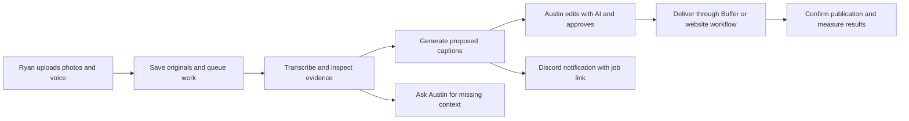

# RHI Pros marketing app: vision, current state and build roadmap

Last audited: October 17, 2026, approximately 4:25 PM Eastern. Source inspected through commit `814c6e5` on `marketing/workspace`, plus ongoing uncommitted Cursor inbox/editor work. This is a living product brief, not proof that every feature is deployed. Inspect the current code, installed worker and live deployment before changing status below.

## 1. The product we are building

A private marketing operations app for Austin to run RHI Pros' marketing service. Ryan supplies photos, voice recordings, dictated/typed notes and location/job context from his phone. Austin uses that evidence to prepare, refine, approve, publish and measure marketing content.

The business outcome is consistent, accurate marketing that produces inquiries and booked work. The software should make that operation easier to run and explain. It should not require Ryan to learn a marketing dashboard, choose AI models, create captions, classify before/after photos or manage publishing accounts in our app.

The essential flow:



The main launch milestone is one real submission becoming a confirmed social post through this chain. Delivering a finished pack to Ryan's portal is optional and is not a prerequisite. Do not keep expanding portal pack delivery while social publishing remains unproven.

## 2. Two products and two repositories

| Surface | Purpose | Location |
| --- | --- | --- |
| `https://rhipros.com` | Public contractor website: portfolio, services, local pages and lead capture | `C:\Users\Alivia\Documents\ChatGPT\RHIPros` |
| `https://app.rhipros.com` | Private operations app and Ryan's limited upload portal | `C:\Users\Alivia\Projects\Manager App\manager-app` |

The public site's curated project placement and owner-approved copy have their own rules in its `CODEX.md`. Do not replace them with an automatic photo feed or rewrite approved brand copy as part of dashboard work.

The Manager App uses Next.js, TypeScript, Prisma, Supabase/Postgres/private storage and Vercel. Read its `AGENTS.md` and relevant installed Next.js documentation before implementation. Cursor and Codex share the working tree; changes can appear while another agent is working.

## 3. People and boundaries

- **Ryan:** simple phone upload, voice/dictation/text and history of his submissions. Google entry at `app.rhipros.com`; his permitted identities map to the same limited portal. Test actual OAuth completion on his iPhone. Do not give him Austin's dashboard or make content approval his job by default.
- **Austin:** full operations dashboard, factual corrections, AI revisions, quality review, explicit publishing approval, scheduling and results.
- **AI/worker:** proposes and checks content. It does not grant owner approval, invent job facts, choose ad spend or decide that content is published.
- **Buffer:** intended primary delivery route for supported organic social posts. Google/Meta paid advertising is a separate integration.
- **Discord:** owner alerts and links into the app. It is not the system of record and currently is not a conversational bot.

## 4. Current state: separate verified operation from source code

| Area | What is known | What is still needed |
| --- | --- | --- |
| Intake | Phone photo/roll upload, voice recording, typed/dictated text and saved submission history exist; a real upload previously arrived | Complete Ryan's own iPhone login/record/upload/reopen test; ensure incomplete batches and transcription failures are clear |
| Access | Owner-only manager access and Ryan's restricted Google portal are implemented | Confirm the current deployed access/history behavior; preserve membership across invitation renewal |
| Local connection | Checked 4:23 PM Eastern on October 17, 2026: Ollama answered `http://127.0.0.1:11434/api/tags`. Downloaded models include `qwen3.5:4b` and `qwen2.5vl:3b` | Show real worker/model health in the owner interface; downloaded does not mean a particular request has run successfully |
| Worker | Scheduled task `RHI Pros Local Marketing Worker` is installed from `manager-app-marketing-hybrid-20261017`. At 4:23 PM Eastern its process was alive, idle, and had just finished a pass with nothing new to draft | The exact-target queue in this Git tree is not the code that process runs. A queued owner request stays queued until that installed worker is updated. Restart and offline behavior are still unproven |
| AI settings | Local/Ollama, Hybrid/OpenAI API and manual chat handoff exist in source and the live controls | Checked 4:25 PM Eastern on October 17, 2026: automatic processing is On, mode is Local, and no OpenAI key is set on the worker. Ollama is running. Do not switch this to Hybrid or a paid call without an explicit choice |
| Generation quality | Checked 4:25 PM Eastern: the three submissions from the last day already have local Ollama drafts and show as Needs review. Two are marked test and hidden by default. The worker will not draft them again | Owner approval is still separate. Repeated caption edits and a fresh quality review of the real job are not done |
| Owner approval | Existing review store binds approval to current draft/evidence hashes; native publishing checks it server-side | Every new generation/revision and Buffer path must preserve these gates |
| Dashboard | The inbox lists those submissions. Opening one shows Analyse/Generate, which posts to `/api/marketing/generate` in this Git tree | That button is not proven in the browser, and the installed worker does not run this queue yet. Do not add another dashboard |
| Buffer connection | Live channel discovery found RHI Pros Facebook and Google Business Profile; Instagram was not listed | Recheck selected/available channels as needed; do not assume Instagram is connected |
| Buffer delivery | Audited October 17, 2026: a connectivity check does not create a draft, a retry does not create a second post after a provider id exists, and draft, scheduled, and published stay separate. Sixteen mocked Buffer checks passed. Nothing was published | One separately authorized real delivery is still required. The installed and deployed copies were not part of that audit |
| Native Facebook path | Exact-approval mock flow, complete-photo retries, durable progress and uncertain-outcome holds were implemented and tested | Native live account/config/database enablement and a real post are not established by those mock tests. Prefer Buffer as the owner-facing route |
| Website | Explicit manual photo publishing to the public portfolio feed exists | Test actual website refresh; build reviewed project/service placement and copy updates rather than assuming all slots update automatically |
| Alerts | Discord alert code can link a known submission or saved draft. Eleven mocked alert checks passed. No live webhook was called | Revision and delivery notifications, visible send failures, and an offline-PC alert from outside that PC are still open |
| Reports | Manual campaign scorecards and some internally recorded lead counts exist | Automatic platform/spend imports, attribution and useful client reporting still require integration |
| Client email/SMS | Owner email and SMS stay off until Austin chooses to send. The only email address is `austinmck17@gmail.com`. The only SMS number is `6104514099`. Discord remains the allowed owner alert channel. Ryan is not an outbound recipient | Do not enable either send path while testing. A mailto draft is not sent mail |

Important Buffer distinction: its **draft** mode creates a real private object in Buffer. It is not an in-app simulation. The Buffer API's `test` action also creates/checks a private Buffer test draft. Do not invoke either as a read-only connectivity check. Native `MARKETING_PUBLISH_MODE=mock` is not proof that the Buffer route cannot mutate Buffer; inspect that route independently.

Some older documents describe earlier releases, including a time before the standalone worker or Buffer existed. Their deployment IDs and feature-status paragraphs are historical. Prefer freshly verified code/live state and update this brief when a milestone is proven.

## 5. How Ollama is connected

The RHI app does not need to appear in Ollama's Apps launcher. The integration is our own code:

1. Website/API saves the source material and processing request online.
2. The scheduled worker on Austin's PC reads the database and private media.
3. `scripts/local-review-request.ts` makes a native HTTP POST to `127.0.0.1:11434/api/chat`.
4. The request includes the downloaded model name, messages, structured-output schema and, for vision, image data.
5. The worker validates the result and saves evidence/draft/review records back online.
6. The dashboard reads those persisted results.

`scripts/local-ai-settings.ts` honors the existing CPU-only configuration. Preserve the owner's PC/game workload constraints; do not commandeer the GPU or install models without need. The app's hosted `localhost` is not Austin's PC. Do not point a Vercel handler at its own localhost expecting to reach Ollama, or expose Ollama publicly to solve that problem.

The installed worker folder last observed was `C:\Users\Alivia\Projects\Manager App\manager-app-marketing-hybrid-20261017`. An older isolated intake release also exists at `C:\Users\Alivia\Projects\Manager App\manager-app-intake-release-20261016-152445`. Neither should be assumed to contain every current Git change. Inspect the scheduled task's working directory and heartbeat before updating a release. Private environment files stay ignored; do not print their contents or copy credentials into this document.

## 6. The missing product feature: a persistent AI editing workspace

Austin wants to open any saved job and interact with the AI repeatedly: "shorter," "less generic," "mention this work," "try a different caption," or "use this photo." This should be available from the job/editor, with the photos, notes and current text in view.

Required behavior:

1. **One obvious entry point:** Analyse photos & write captions for a selected submission; Generate caption when no draft exists; Revise with AI when one does.
2. **Persistent context:** originals, selected photos, transcript, owner corrections, photo observations, current caption and previous revisions stay associated with the job. Reopening the job restores the conversation and chosen version.
3. **Useful quick actions:** shorten, change tone, improve clarity, write another option and adapt for Google Business. A text instruction box allows a specific correction.
4. **Proposals before replacement:** show the proposed change with Apply/Keep current. Preserve unsaved owner edits; reject or clearly separate responses based on an older revision. Never overwrite a newer edit when a slow request returns.
5. **Versioned saving:** applying/saving creates an unapproved version with parent/source provenance. Keep the original recording and raw transcript separate from owner corrections. Never rewrite evidence to make an invented claim look supported.
6. **Reuse valid analysis:** cache photo inspection and factual extraction against the exact source hash. A tone-only rewrite should not need to retranscribe every recording and reinspect every unchanged image. Changed evidence invalidates dependent checks.
7. **Honest quality gate:** microphone tests or a dog photo do not establish construction work. Ask for details or an explicit company-life intent. Do not force every photo into a contractor sales pitch. Before/after remains an internal suggestion that needs evidence/review, not a task for Ryan.
8. **Separate approval:** a passed AI check is not owner approval. Edits invalidate the applicable approval; publication requires the current approved version.
9. **Existing posts:** editing an internal draft does not automatically edit a live Facebook/Google post. Initially make a new draft. Updating an existing external post is a separate explicit action that must be supported and verified for that platform.

An always-visible editor does not require a model to generate text continuously. Persist the context and run inference only when new material arrives or Austin requests a change.

## 7. Availability and engine choice

Recommended architecture: **cloud website + durable job queue + interchangeable inference engines + one shared review/publishing workflow**.

| Engine | Appropriate use | Availability/tradeoff |
| --- | --- | --- |
| Downloaded Ollama | Private/local processing and avoiding metered hosted inference | The host PC, worker, Ollama and network must be available. Keep queued work when they are not |
| Existing OpenAI API adapter | Short path to direct API-based drafting/review | Needs verified API credentials and budget controls. Today it is called by the PC worker; making inference hosted does not by itself move orchestration off the PC |
| Future Claude API adapter | Alternative hosted model if quality/cost evaluations justify it | Verify actual account credits, credentials and output contract before offering it as ready |
| Supported Codex/Claude agent or CLI runner | Optional private owner-operated subscription route | Separate adapter, authentication, usage-limit and structured-output work. Do not equate browser sign-in with a configured inference API |
| Existing manual chat bundle | Owner-directed review in ChatGPT/Claude | Export/import with source/hash validation; it is manual, not a background connection |

For editing that must work while Austin's PC is off, use a cloud job processor with a hosted API or another independently powered host. An Ollama model on a sleeping/off PC cannot answer. A spare always-on PC is an option, but requires a service, updates, monitoring and recovery. If a second local worker is added, both must claim the same durable queue atomically; never let both generate or publish the same job.

The primary engine/budget choice is not settled by this document. Preserve existing settings until the owner chooses. A local request must not silently become a paid request. API billing is not automatically covered by a ChatGPT subscription. Current Anthropic documentation describes supported subscription SDK/CLI usage and API credits for some plans; verify the actual plan rather than assuming all subscriptions work identically.

## 8. Queue and processing contract

Reuse the existing generation jobs and review records. Extend the current queue where needed instead of creating another approval system or a competing dashboard queue.

- Persist an exact org, submission/job, selected asset set, source hash, base draft/version, requested engine and instruction. Derive org/user from authenticated server context.
- A submission-complete signal should trigger initial processing after photos and attached voice have finished arriving. Debounce partial uploads; avoid generating from half a batch.
- A deliberate owner request should target that exact submission/version and work while automatic generation is Off. It must not flip global automatic settings.
- The current org-wide `testRequestedAt`/`testDraftId`/`testSubmissionId` setting is not a sufficient multi-request inbox: concurrent requests must not overwrite one another.
- Repeated clicks deduplicate; two different jobs remain independent. Use atomic claims, durable progress, bounded retries and recovery after interruption.
- Check source/version identity before inference when possible and again before saving. A stale response cannot overwrite current content.
- Local availability failure means waiting/retry, not lost input or invented success. Distinguish paused automatic processing, missing credentials, model failure and stale worker heartbeat.
- Preserve existing safeguards for private media, voice failures, held evidence and org ownership.

Logical UI states should include Received, Waiting for voice, Queued, Waiting for worker, Processing, Needs details, Ready for review, Approved, Scheduled, Published, Failed and Outcome unknown. These are a presentation/workflow model, not an instruction to replace every existing enum or apply a Prisma migration. Map current records truthfully. Only the provider's confirmed completion can become Published.

## 9. Discord integration

Keep the app as the place to review/edit content. Initially Discord should notify Austin and link directly to the relevant job, review or delivery:

- New submission received.
- Draft or requested revision ready.
- More context needed.
- Processing failed or worker unavailable.
- Scheduled/confirmed published/failed delivery when those states are implemented and verified.

Use stable event/version IDs and an outbox/retry record. Notify on meaningful transitions; do not send a message on every poll, every token or every unchanged failure. Surface notification failures so they are not silently mistaken for delivered alerts. Keep sensitive source notes, recordings, private media links and capability tokens out of Discord messages.

The existing `src/lib/marketing-alerts.ts` can send messages through the configured incoming webhook. That webhook alone does not implement reading Austin's replies or slash commands. If conversational Discord control is wanted later, build a separate authenticated application/interaction handler with owner authorization and version checks. Start with links; do not make a Discord bot a launch dependency.

An offline PC cannot report its own outage. A cloud-side heartbeat check is needed for reliable "worker offline" alerts. Preserve configured owner alerts; do not enable client email/SMS as a side effect.

## 10. Dashboard and editor design

The dashboard must answer: **What arrived, what needs me, what is running, and what actually went live?**

- **Inbox:** one compact submission card, thumbnails, job/town when known, time, note/transcript summary, actual status and one next action. Hide explicitly marked test/demo uploads by default, without deleting them.
- **Content:** reusable jobs/assets and saved versions; reopen/revise intentionally. Keep useful source inputs for future posts.
- **Results:** delivery history, measured marketing outcomes and reports. Unknown data remains unavailable, not zero.
- **Settings/More:** AI configuration and worker status, Buffer connections, permissions/access and secondary business tools.

Open one job/editor at a time. Default it to photos/evidence, social caption, Google Business text, AI revision and review/approval. Put ad drafts, exports, file assignment and website feed controls behind secondary actions. Avoid multiple report destinations or duplicate platform setup links competing with the main task. Model selection belongs in Settings, with a small clear engine indicator at the action.

Keep correct contrast, visible button labels, keyboard access, phone layout and unsaved-edit protection. A template action must remain labeled as a template. A queued request must not display "Generating" before a worker claims it.

Cursor is actively changing `marketing/page.tsx`, saved/results screens, `manager-navigation.tsx`, `marketing-job-review.tsx` and an inbox view model/test. Inspect current Git status before assigning overlapping edits. Those changes are not proof that Generate/Revise is connected.

## 11. Publishing and website behavior

### Organic social

Buffer is the preferred primary route for Facebook and Google Business, with Instagram only after connection/format testing. Reuse existing owner approval and evidence hashes, server-side org/channel/media validation, provider adapters and delivery records.

Before declaring launch-ready:

- Verify selected Buffer channel ownership and availability, per-platform copy/media selection and private media retrieval.
- Show the exact approved text/photos/channel before sending.
- Keep in-app simulation, real private Buffer draft, scheduled post and confirmed published post distinct.
- Save provider IDs and confirmed post links; reconcile delayed outcomes.
- Never blindly repeat an uncertain create-post request after a timeout or process failure.
- Verify duplicate prevention across Buffer and the native route if both remain exposed. Their existing record identities are different.
- A Buffer private draft must be deliberately promoted/scheduled through a supported, reviewed path; repeated create requests are not a safe promotion mechanism.
- Intentional reposting needs a new reviewed version/explicit publishing intent. Preserve safeguards against accidental repeat submissions and time-sensitive wording on old jobs.

### Website

Keep explicit public-use clearance. The existing website photo-feed action does not automatically update curated homepage features, service pages, project stories, SEO copy or before/after case studies. Build reviewed placement metadata and a website publish adapter when that work is scheduled. Preserve the public site's curation, image-stage rules, original evidence and approved voice. Verify actual refresh/removal on the public site.

### Paid ads

Treat ad creation, spend authorization, campaigns, tracking and reporting as a later separate workflow. A social post is not a paid ad. Draft/paused campaign code and mocked tests do not prove live account access, serving, billing or measurement. No model may activate a campaign, change budget or claim ROAS without the relevant authorization and data.

## 12. Results, reviews and service operation

Build measurement around business outcomes: attributable quote requests/calls, qualified inquiries, estimates, booked work and collected revenue. Record campaign/source IDs, UTMs, date ranges, timezone, source timestamps and attribution assumptions. Deduplicate leads rather than adding all platform conversions as unique people. Revenue is not profit; missing spend/data cannot produce a meaningful ROAS.

The existing manual scorecard is useful while imports are built. Platform insights/ad-spend import, website attribution, call tracking, lead outcome entry and weekly reporting need individual verification. Do not assume Buffer's currently available API covers every requested analytics metric; check its current documentation.

Later: completion-triggered review requests, customer follow-up and verified integrations/imports for Joist, Houzz, Yelp or other channels. Check current vendor APIs and platform rules before promising automation. Do not rebuild estimating/invoicing/Joist as a dependency for getting social posts live.

Austin's service should be defined by deliverables and measured outcomes: content preparation/editing, scheduled publishing, selected website updates and reporting, with paid-ad management separately scoped. AI efficiency does not need to be disguised as manual labor. Scheduling/turnaround labels describe actual delivery timing, not hours supposedly worked. Pricing is a separate owner decision; this roadmap sets no rates.

## 13. Ordered build packages and acceptance

### P0 — Make one selected upload usable with local AI

Build the real Analyse/Generate action and persistent exact-target request. Show actual worker/engine readiness and queued/processing/context/error states. Reuse existing inspection, transcription and review gates. Do not rely on the generic one-test-cycle control or a browser talking directly to PC localhost.

Prove: own/foreign asset handling; one selected job only; two queued jobs survive; repeated clicks deduplicate; automatic processing remains Off; local path makes no paid call; offline/restart recovery; changed evidence cannot save stale results; generated output stays unapproved. Use synthetic mocked tests before a deliberate local inference trial.

### P1 — Complete the owner AI revision workspace

Add persistent instructions/conversation, quick revisions, original evidence display, Apply/Keep current and version history. Cache unchanged evidence analysis. Keep ad fields secondary. Coordinate the new action with Cursor's inbox work.

Prove: an owner can reopen a job and refine its caption; an older response cannot overwrite newer edits; factual corrections remain separate from raw transcripts; insufficient evidence produces a specific request for context; edits invalidate publishing approval.

### P2 — Prove Buffer delivery end to end

Audit existing Buffer code rather than rebuilding discovery. Verify simulation boundaries, transport/channel identity, approval rechecks, status reconciliation, private media lifetime and uncertain delivery recovery. Then perform one specifically authorized real job/post trial and verify the actual external result.

Prove: exact approved text/photos were submitted to the intended channel; no stale/unapproved direct API bypass; no duplicate on retry; draft/scheduled/published remain distinct; confirmed post ID/link saved. A private Buffer test draft is useful evidence but is not the launch milestone by itself.

### P3 — Make processing reliable and owner alerts useful

Choose the always-on hosting/engine route with the owner. Keep the cloud queue independent of any browser/chat window. Add cloud heartbeat monitoring, per-job Discord links, revision/context/delivery notifications and visible notification failures. Verify installed worker updates and restart behavior. Add a second host only with atomic claims and monitoring.

Prove: an upload while the PC is off is retained; its true wait is shown; the selected engine eventually processes it once; Austin receives the appropriate event notification; outage detection does not depend on the offline PC.

### P4 — Reporting, website automation and ads

Connect real metrics and lead attribution, produce a useful weekly report, then expand reviewed website placement and customer follow-up. Add paid-ad account/budget/measurement work separately. Expand platforms only after Facebook/Google Business are dependable.

Prove: reports distinguish measured zero from unavailable data; inquiries can be traced to sources where evidence exists; website changes appear in the intended placement; ad budgets and publication actions remain explicitly authorized.

## 14. Release and agent handoff rules

Before writing code: read this brief, `AGENTS.md`, current code and Git status; identify the installed worker and current production deployment. Announce ownership of a small package. Do not reset/stash/revert another agent's work or stage all files indiscriminately. Avoid overlapping worker/editor/schema changes. Use current session authorization; this roadmap alone does not authorize external publishing, ad spend, client messages, paid inference or production migrations.

Useful focused checks already used in this project:

```powershell
npx tsx --test src/lib/publishing/publishing.test.ts src/lib/publishing/approval.test.ts src/lib/publishing/readiness.test.ts src/lib/publishing/providers/facebook.test.ts
node --test scripts/check-buffer-setup.mjs scripts/check-buffer-delivery.mjs
node --test scripts/check-marketing-evidence.mjs scripts/check-content-review.mjs scripts/check-generation-queue.mjs scripts/check-worker-bugs.mjs
```

Run relevant TypeScript, lint and build checks for actual code changes. Earlier focused runs passed 55 native publishing checks and 16 Buffer checks, but those counts are historical and do not prove the latest tree builds or production works. UI changes need real desktop/mobile inspection. Do not run paid/live worker actions merely to validate documentation.

A code push is not a verified deployment. A web deployment does not update an installed PC worker. A healthy process does not prove the selected model processed a job. A saved draft is not approval. An accepted/scheduled provider request is not publication. A notification record without provider confirmation is not delivery.

Every completed package should report files, tests, commit/deployment/worker versions where applicable, actual observed outcome and remaining blockers. Update this brief's current-state table with the date and evidence when a milestone is truly verified.

## 15. Code map and supporting material

- Intake and portal: `src/components/crew-photo-intake.tsx`, `src/app/portal`, `src/lib/field-intake.ts`, `src/lib/intake-audio.ts`.
- Dashboard/editor: `src/app/(app)/marketing`, `src/components/marketing-job-review.tsx`, `src/components/manager-navigation.tsx`; inspect current inbox work before editing.
- Settings and manual request controls: `src/lib/marketing-processing.ts`, `src/components/marketing-processing-controls.tsx`, `src/app/api/marketing/processing/settings/route.ts`.
- Worker and inference: `scripts/intake-marketing-worker.ts`, `scripts/local-intake-runner.ts`, `scripts/local-generation-queue.ts`, `scripts/local-evidence-pipeline.ts`, `scripts/local-review-request.ts`, `scripts/marketing-ai-request.ts`, `scripts/marketing-worker-service.mjs`.
- Evidence/review: `src/lib/marketing-evidence.ts`, `src/lib/marketing-evidence-store.ts`, `src/lib/content-review-store.ts`, `src/lib/content-review.ts`, `src/app/api/marketing/review/route.ts`.
- Chat handoff: `src/components/marketing-chat-handoff.tsx`, `src/lib/marketing-handoff.ts`.
- Delivery: `src/lib/publishing`, `src/app/api/publishing`; see [publishing handoff](../src/lib/publishing/README.md).
- Owner alerts: `src/lib/marketing-alerts.ts`, `scripts/marketing-worker-result.mjs`.
- Reports: `src/lib/marketing-reporting`, marketing performance/results routes; see [campaign reporting](CAMPAIGN-REPORTING.md).
- Operating references: [AI workflow](MARKETING-AI-WORKFLOW.md), [standalone worker](STANDALONE-MARKETING-WORKER.md), [Google portal](RYAN-GOOGLE-PORTAL.md), [review workflow](CONTENT-REVIEW-WORKFLOW.md). Treat historical deployment notes as dated evidence.
- Earlier Cursor packages: `C:\Users\Alivia\Documents\ChatGPT\RHIPros\Cursor-next-marketing-packages.md`. They describe incremental work; inspect what has since been implemented before reusing a prompt.

Official references checked during this discussion (verify again when implementing vendor-dependent features): [Ollama local API](https://docs.ollama.com/api/introduction), [Buffer API](https://developers.buffer.com/), [Discord webhooks](https://docs.discord.com/developers/resources/webhook), [Discord interactions](https://docs.discord.com/developers/interactions/overview), [OpenAI authentication](https://learn.chatgpt.com/docs/auth), [Codex automation](https://learn.chatgpt.com/docs/non-interactive-mode), [Claude SDK/subscription access](https://support.claude.com/en/articles/15036540-use-the-claude-agent-sdk-with-your-claude-plan), [Claude subscriber API credits](https://platform.claude.com/docs/en/about-claude/api-credits-for-subscribers).
